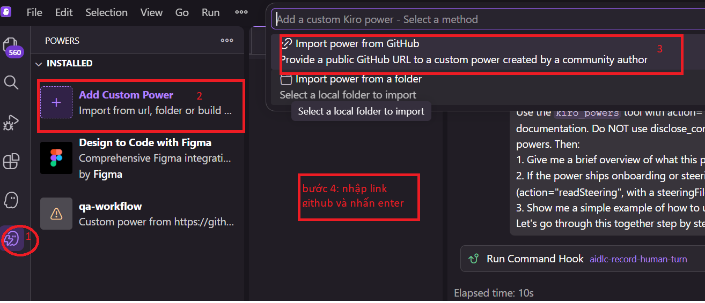

<img src="data:image/png;base64,iVBORw0KGgoAAAANSUhEUgAAAGQAAABkCAYAAABw4pVUAAAe1UlEQVR42u2deXRd1X3vP7+9z3Dv1TxYNtgGA54wg5kDpCBDSghTmmRFxqZJmtKUpEkLabL6kpe0FU7ee03pygsZSvPaDB1Im+CSdDVpgAxgMRNsHNuAjTHGBteDPEi6ku5whv17f5wrWQKbAAGkGO21zrpL0tW5Z+/v/v7m374wNabG1JgaU2NqTI2pMTWmxtSYGm/ssL/pE1AQwCwBWQWs+A2fj/ymPXA3GDoxT/agKyE91Hu6urCLehF6cCvATfHuddg4XV3YQ22gT5xJ+58uZuafLmbmp8+m7VAMqv3vFENei9EFdiwTPnWmf0qU6NucugsdshCYAeRrkykDu4zoJsHc5yM/vWld/MTIXLtBJjtjZJKzwqxcSdoNpniaWabKdU7lgtBiFMEpOAVFUc1mYwBrstcoJTGiq4zK331xffr9EXG2cuWhRd0UIC+hqGsPptefZi+xqv/Ht+Yso4KqICqJERFARLI5KEqqSqKqiaqmqorghSabZKrc54x86strk4e6wawAzT5qysr6lUr7ItCuLuwlnv1izphbcuIdbdSmnhj1jDGexViDMYIICIqAiBWRQIyExhhPjAE0cuoSRX3DHJQPnj/d6hf2uJ6Rz+qZZKDIZANjBbhrF9DQkvO/3+ib305VXOAJnocZRWCEPppdzilJCnGSvaJgau9JVKloSuQ0NYLJe0g11X83efeBLz1MeeQzpwA5hJi6EaR4LmFdNfdfjTm5yFmJPYs/FoBDTmLMLJIUqpESRZleGQGmoo6ySxUlKfj41VTuLnvJVUetoXIjqEwSppjJsjFWdmU7tVDJfTdvuchZ4sDHH8uEw4KpBy/PQl1eaKw3BL7UlD7kxFBvrIjgl2Li0OrFudj8242gK7swk2VzTgodclsXdulK0s8sDv93fWA+NBwTixHf9w5SQ2sa/GXvNANBkIm4JMlA8UTwxBDjbJwS531Z9MNpJv9n9+hPujvxerZPvOia8F0xYoZ+9vTchYGhJ3YkCtYI0lhvEAFjPUSENIlf+QQF4gSGSw7nMhEWqzLkEhUlDSxemnLJzRvSn00Gk3iiAZFuEBbhJUG4OrBySpSSimBVoZAXwkDJN7RhrGWob+8rYslYUJIUhoYdTjM5XVFHKU1dYDGpstnm09MaH6Y60ebwhOqQ7k7sCnBpGL6v4JlTopREJBOjIlCpKqqG6vAApWJf5m3oK1+rEd1SXzAIB3VKYIyJUpKcYb5WvOtWgOvunFgxPpEMEQX+/ky859LcusCyMHKojNkkqpALhbqCwTklV99EmsRE5SFEzKtiSjVShkuKEUhRBtPEWUFSZUerny5csYbyQcPvTcSQ27owAvpcEl4UWjmx+gIwDi4gDA9XcS7FWp9CQwtBroA696qYEgZCGGTWl0UIjTGxw4WW2cXYvBPQiWTJxJu9RpYbQUVfbOEYY6hUypx29tuZ1jGLvt4dpElMvrGNoFCH6qsDJZ8TjMkoEIjBCKqKpsI1AE/2vPl0iDyxEr2tC6uqb0ucCjL+WYyxlEol5i84mUsvX8YlV15LQ1MbfXt24JKYQmMr+frm2iK/MmCMyZiiNZb4YmysiDq54M/Op2FRhpW8afyQ7k68FdtJZ/v+79V75gOxyyyrsWBUKiWmdRzF8t+7HtKEllnHM+/8S9i67kEO7H6eIFcgKNTjByGaOlyaoOjLtsKsFaJYRxSpVJ2moUehUrE7/qbX/WKi/BI7IfGq7aQfXsQ5Bc9+z4jxapaoZAtlqZRLtLS2874P3kBTUwupKsG0DuqmHc3CMzvZ+/wWdjy9CRFHkK8jzNdh/SBji0trjNHxVkvNvNJR0AXnMh/FiBCrE6eob+RtZ0wzd//No+65iQg+ykRYVh9fTFPizNpG35tj1bgR0SkilEplZs46hqvf90e0tnVQGR6kbuYx+K3taBQhQQ7F8eAP/5mH/utWomqFhtZp5OoaEWNxaUISVUnjKmma1ADS0ekaY0AEl0TECQwOOwww5BIipy5nxUSpbjcmPe3mdQzIG2xxvaEM6ezE+/3tuHM67KWhJx9RZxJfxI6A4dKUkxefzdXXfJiGxhYq5Sq5tumEHTPBgVgfdYqI5ZjTL2TeqedRGepjz/bNDB3Yh0uqWM/DD0P8XIEgXzfKoDBfT1jILj/MkUQVjEAUO9As3JuikjqS0KM1Sc3Dl/fqps5OvO1voOjy3khAOjqynWZUehOnCM6EGIwYylGFjlnH0rXsD0icoVqt4gcVgkZBSzsz82hs2H1oB9M6WnnXx7/E7qdWs/7+H/PM42vo37sLxeB5Fs/3sZ7NWFFT/mnqSGJHVC5iBKwJKadKUjMMVDCJA6fSO/aZj0hAanEiaW5LHj3QZzdZowuLaeIC65mSEwhCUttIWn2eoPefEAaIdvlwKCtKDJqUsB0XMOPMTzPjxHMYvv+z7Hh8Hzv78/QeiCgOJ1SiiCTKoiHGGvIe1OUqTDttCXNOu5Qfff/b7N76DL5vUFXnG0yUsqm9LXkUkDc6tuUxEeGSHpLrT+V2X/hsRcSVooopDkI0sAv3zO2YZD1exwy8eX8JLhoV4sYYnEszS0osGhWJfnkj8dP/Cerwi4+x4D1fYUHYAElKEjkSZ4iiGFTxPIsf5DDPfh0pDWPyu/mP0n6KAynNzSnW+s6KM1a5fUUPSXcn3ooekiMakIPKXbeKsVSGYqbP6OAdXVcxf1YHprQOtB/TehXSfCJEB8CGiDG4ahmTr4OoCqpIYwHbehLlR74CAvm5Z6ANp0FaAs/gNYZ4lWFyuXzGsrgKQStJ32mUn/sm2p/j3dd8mEXP7eYXd/+I3t295Bp9sOkzE+WHvOGAPJnJZDXGO7tcijj59DO49pP/i/oZM6FaAfkA0UN/jFYHwFVQF5MmVXp+8E2e37KBMzvfySkXXIlGZUQMrtJH4axrAUh7VyGuiqYVJMiz4Z5/Z82q/2T23JO58N0fwrMGSSoQFfE7TsJf/DkW1FsW5Ou4+PL38q0v/jlbNjyGzQVnQ/TtkzreeI/dvOGZwZWk3Z3T6qvV+F1N7e384Sc/b+pb26k8+zTlZzdDPAiaZDpCQXIFntu4lg0P/ZRKaYiHf3IblYH9iBdkwS5VJN+M5Jtril8QL6A8sJ+HfnIblfIQGx7+Gc8/9UskV8hWWAy4BKJBSs9uprJ1M/Wt7Xzok583TW3TqFTid3d3TqtfWtN5RywgXVmqlHKp+laNdcbZF1zq8jNmmequHUR7dpJWytlijXWSkoTG9hkUGpooDw3SOn02Xr4eXHrwXS6t/VxbO5fi5+tomz6L8lCRQkMTjW3TIUnGr66xuEqFaM8uqrt2UJg+y5x94dudxjqjWq6eP/aZj2gd4mya+hZmz5nvNE1MMlTMdraxgEEKs3D9G8EGaHmA9lnH8TvXfopd2zczf/Fb8TwL6kFcRMu7kMLMLFdS3gVxEWwdnpdw2TXXs3ndgxx17ALaZx2XOZb5RtzAJiR/VPZZNUcxGSoSuITZc+Y5z2ISk05IOte80WZvN5hzZg/dUyzzY5NWPDE2FWMPVjGkZbxjrsL1P0H6zK1I2ALkmX7iWzntyg9T6DgBTD2IEq2/CcnPwDQtxDSdiORnEK2/qVYPX0+hYy6nXflhpp94PpBHwhbSZ27FHdiAmXEpmlYyVqkixiLGpiateINlfnzO7KF7uskqJ49ohtwIym3oZ4Tl73p2y88XG87yW9pcWioZF0VoXEIajsc/5X8QP/5Fkp33YBqOHQ2BiDGgDte3AbF5gjM+NxrZCBZ/luixv6Ry7wcwLadkesi5rLzRWNzgNrS0A+/EjyOF2RAP46II8QP8ljaHwW59dsvqB59j+T9tx3XJG9/e8IYHF7MJrjA/uFcqc7yhny487oRrW+afFHqeh3ieSJjDkGIa52FndIKrQjyIiMkuQIyHd9RF+Cd+FPGbMl9FHeI34c28FPHrIOrLShrF1CLAimlaiH/SDZjCXDQawInBFOoJp01X76iZsuOXjwz+YOV3L/7hc8U96I3mognIi8jEZQy77NKVK9NPndt+5/v/6E8vPektF6eEOUsSQ2k42/U2AFs4fGmdK4OmBw2BkYprm89+p4eYbTRMWuxFneI1t0FjC1TK6ROP3G3/+etfuvOmh/ZdNvJsbwo/ZFSfsBJVlY8ukn1//9efZda8hdrWcQxHz5rNO977+2gSIy6GtO+Q+0jVkZYrByO5kgFifB8bxoeurBODq5RQp9gg5Cc/+Bd27NjB/j3P6Y4tm4iU/aoqS5dOXKnBhAGyqBcREf2TxV4lZ0mf2bRJN23YhO/D6W/ppGPOPFyljDH2xTlY3yfau5t9qx9EPH/U/9A0xW9opOMtF76Y+yJoEuOqZWwYsnf3f/Mf3/sW1TL4AdpU56WklEVEuzsnTnJMeE5dnLvPitpczvebmvOJc8Jd//EviB8cZpcLpCl+Ywt+fSOuWq0lphwujshNmwGe9+L/VYcrD2dKPsjxsztvJ46hsSWX5HK+b0WtU3cfb9ZS0p7tuG4wz3bqBm+PESt6ui9pXjzDti3PMPeEuUw7YSGuUsosqxewRHyfsHUaSaWEi2OM59Nw3FwaT1gIzo2pwM5e3fAQLirjNzSzZcOjfO873yKXswSSGqdaLCfc1LvQfbXrSWTF9omrXpw01e/XL+IY8eRjIvYTUexMU2ub/M+//oY0tE/HlYYx9hCiy2Zth65SQqxFwlxWyDuWTc7hSoOkUQU/V2Cw2M9Nn/+k7t/Xq2HgOeeSL+Hr176yhueYKrY+WN/77R76H9nDz86czt660F514MCg27bpl+b0t1xAUN+Ii6PxxXG1xc7MXT/z8tOU0QYSETSu1sCICAp1lCsl/u5LK3hu23bXWO/bapp+7Gvr9a8e2cVAVxf2yScnviVBJlu784oeko+dYp7I+3ZBfzHW4+cebz90w18w7fgFouUKKjKaARxrAY/ORHVUebuogojBa2xi747t+o2//QJbt2xJmxp8U43TjV/b4E7u7sSbTO3Tk6alrQd0yRxMz3bcuUfJQM7wXi/0zb69+2TNQ/dIfRi42bPmqHieEFfRNB1pn8oCi0mERlVctYRWy4gqXl09xlr38L136bdu+WvTu2uX1Nf5JhAncconftGrG5bMyapgmOqgeum2to+dYv/KN7pcxTbGcZLXRHMLFp3EBW+7Kj1x0WIb5HJjHL8x9T01cRVFVTY9sS697+f/aTc98TjiSdn3vYpoWkyc/OvXNqSfmWztbJO+T/1P5hJST2MhDOtiZ08uFUtfSCJOek/X1emll73XVqMK1g8O9hwCaRQRBiF33XF7+v2V37NewBOFxsKnU5M+7qrVYYYofnUL1ck6Z2+yPlhXF/arK6kCe6G6F9j2xa5zH3xi7S9ul7i8REslVx0cMOOsL1WccwQNTU7islVjeuades57Prny4QOHahJiqk/91RXWAdzYif3cfTY54/TLCt/56Nn/tuDUM68q79/vcGpHKuHFGDCS5tvazFPr1/zwg//w+LJHfvH98l9ekHo39mQAyAS2Ghwxh8+oqgDm6Tu+4s2//Iaqrv6vG8jnb077B2Ihawwdo01i29zkUy5/XM664subf/zlcN5l1yeAExGd7HOdbCJLuru7x22SJUuWGBFJyM47SQ+Uos5o+9pl3sBuVVV7iBiwdYNFjZuOWt5Xjte35P174AYA7rnnHm/VqlXjlPiKFSsm1YkOk6Dps8v29vbKkiVL3IoVKw5p8axevdqfP3/+71hrPmrC/EW53VtIn14LQfjimJUIRFXsvNOpHjWPpFy6V1Vv2b59+w9OPvnk6DAclM7OJbajo0NXrlzpJhIgmUggVr4g53DdddcVhoeHWyOo6+/tzc+YMUO+/NWvnh8GwYdzudwpqFIsVzXY+ZTmdm026gWHBESSiMpR81316AXSlA9FjKFcLj9ZjaKv3/Ann7h/9+7ntaOjowwMi0jfrbfeOvyrnu2IBaS7u9uMFRPLl7//PBW9QuCtqswVoTWK47Bv3z4rInzrH7/FMbNnc6C/z1ljVYyxRBXymx/CJPH4YxxGPHXPpzT/PAjyqEtT5xwtzc32ueef59rf/wPUOVra29PA96ugfcNDw9sHBwYfCnLej+66665VY8Xn4Vh7RHjqXV1d9pZbbnEA11zz/q5TTl38DyLc6PvBhSIyB7TRGOMPDw2ZOI4pFouaz+fdWeecQ7VSNcYYgyoa5lHj4ffvrgUYx7AjTajMWoRr7kDSBBExqmrCXM5959bvuEcefljCMBQjYnL5vC9IYy6fn63qzq+UKx88/oS57zzhhOPLW7duXdfT06NdXV32ySef1COOIZ2dnV5PT0/ynvcsn5fLe1+x1r5DVYnjWEWoRQURVZX9e/eSpqlEUcSxc47lb2/52/HxK1XUeuS2rMYf2IN6maElSUzc1EFl7tlImoxjj6rysT/6GNu2bSMIAqy12jZtGiKoiKiq6r7evUbVGWs9VN0qY80f33XXXU90dnZ6q3p60pe5oDrpE1QjYCxbtuyKXN572FrvHXEcp3EcO8kqpz3AioiJo0iSJBGAXC7Hs1ufZcOGx8nn87iRztvamUzRzAW4kYyhKs7ziWaeiIwcjQk458jn82xYv4GtW58ll8sBkCSJpHEkItakqVrEeg3NzSZJnIviOFGVJXHsHursvOS9PT09idQW+1dd2v3rran3Binv5Oqrr7naet6/qapEUTUREe+F/YAiQqWS5clFpHacRkrPqlWc/9bzxnVCkaa4QhPRjLnkdmwEoDLzRFyhEUmiUXaoZm0Iq1atIk2Sgz2IqhwoVjmqI4fxAFLq8yFxfd6USyWjaZRaYxoC36y88rcvuvaHx99z6x3hXNNR3TKqU84888zxkz0T5Kw18aQVWSPWytJrrrnIN95PnXPisjopcxgHkH29vaNMEBGSJKG5uZmv/7+v09jUSDJ2UQEVQ37TAwCUF74VGdNLoqp4nkexWOQj132E/v5+PM9DcJQiQ9dp/Sx/Sx8mUUQV8SAuKsUtCTUJ6UaSMO1BdZso4kZWLYXcdKFwjOBSMIgjtIbI3Utj3R9y2ZZI5JWLr9eTIWbRokX6vve9ryN1/CtgnXPucGCIMVSGh0nTdHTBVZUgCNi9ezePPvooV151JQMDA9gRRa6KWEN11qKDoZMkHWXHiLi6++d3s3v3bhobG0lrSazAg6WL9zOjcRjiEIwHngIpDYV45BZmpLbIGDNnnKIQIRd4UAgwSc0lTatQb99PcfhmER7T27Cy9JXFzMzryA5ZsWKFixP3f33fn5EkSSIvcR6GANVqFefc6DUCiojQs6rnRezAGMQl7C5ll7gExij/EYatWrUKERkVeWnqEBxxqqjWUzznuxQv+DnFC+9n4JSbiUtFolSJEkeUqESJoxIlbvSKcdXiHjc4/Xfc4IUPuMG3/MgVf2uVSxrPSikNpZh6b1LpkFFRtfR3z7bW/m4cx6mIvORnOeeob2ggDMMMkDSlXC6P7vL169ezbds2jjnmGCqVCsZkVYy9vfsYHhoEYA/K9I5paO1+uVyObdu2sX7d+lGjwBhDoa4O63l4RhDjQcNcCNuAFDn+EuSkK2Hbg+CFY512c5AeKRx9Mpzxe2gwA6hHg3rUb1NcKvivPmb2uip1MfoJz7NEUfqyHtDzvEzG11gQRRFpmuJ5Hv39/Txw/4PM/eBcyuUyIkJv714Gh4ZGa7eGhoYAMlBq4u7BBx6kv7+f5uZmkiTB8yxNzS2155Na1rGalaO6CLwAs/wfYXD3YXaOZhnKfAvkGqB0IDuX1iVZX8uvqZa916cpZ2W6bNmy6YhcEcfxy3ZAR8RTmqYM9PURRdGoqAmCgPvuu4+rly3F8zz29O5laGhonH9ijBkHSqVS4b577yMIgtF7V6sR+/ftpaW1dYz4qxm1I408CDTNHO9R1A4ekHxu7HlFQIgWB+E1OiXQex18DtvT05OomiVB4DfEcZy+7IhADYz+A31Uq5XRxR4RP09v3szatWs5ds5xFItFPM/jUAfWFItFcrkc27dtY/PmzeRyuVGdZESolMv07d9fO1HohTXAmbltNBlXO+ESh/oeyf0PkTz2OKalCTdYwnS04V96weSvXBThvFr+QV/+wUDZYlUq5YOW1BgFHUcxd9xxJ+Vy+cWVJy8ApVwuc8cddxLXWDZ2T1trqVSrJKMWmR602kQoVyrs3N3L7j172bVnL7t29xKlKZKkxP94O4X6BuJv3EYuTuFnD5BuegbJmVd1OtHrDkhHR4fWGvAX1BJLL5vHzjkKdXUU6uoy8/QF4izMhTyx4XEGBgYydhyq1FQzXVQcGOCJDRsIc7lxp9Bllagp+XwBzz9YFzwCpLUW7wWX9Ww2CWNww2XMUR10/Ojb5JdeQbq/D7HmNYvXm9e+SyoLW4vKNFUdyfa9AmYJzS0thGPEzAggvu+zZ88eNj65MbPGDgGIU0cYhmzcuJE9e/bg+/44QJxzhLkcza0tB0NdNVAGh4bp3buPoeESfuDj+R6e7+F7fq03PosQpPsOYJoa0HIVHRzOApw62YutRcNXdz5iJjZaWltryti96O+rH330Jc9ePNx7RoyDlta2WveCjquzq0ZVyuUypVKJoaHh0WtwaIjUOUhSTF0er7WZ3ndeS7x6Hf6849ByGTFHcNWJqmKMobWtjf379o06hCPKfdPGjezZs5u2tnbiOH6RZ79nzx42btxELsyNczA9z8vAMDJO2o1Ycu1tbYeVsOoypW7f/XaKD66GcxYz9Pgm5MTjCRecgFb0VZ0D+RtTBpQFBe0oKCMhFWstAwMDrP/lei697B2jpvFYQNavW8dAfz/19fU451BVbO1exlqcKnKIhc/AewkJGycU3nUZ+q7LxhrLJENDpE6P7LqskQW2nkdLWxsH9u0b3e3WWtasXs1Fb7t4nAUlIkRRxJrVa0attBG2tbS1YT0vE4kv08AYl/gS8G3Ij++/hS171lIIGhmuDtCQa6HrvI+Tr6tDXwNFMqkBGS/3Wzmwf/+o2Nq6dSvbt2/nuOOOo1pr2gnDkG3PPsvWZ54Z9T3G6iP3q04yrbFycHCIffv3jYogVWXG9A5MTtjet5He4Z30967jnWd9iBnNx9Jb3MEJjTOPfIa80DIaASU7rbTC2jWPMW/+PCqVymjoZc2ax6hUKqPiqrWt7UUW2+FDPQZVJZ/PMWP69HF/y4V5StVBzp13OQtmns5jz97DJacu53sPfplTZ/4WI18q86YAZNRbz+dpbmlhoL+fwA/45dq1XH7lFaNO4tDQEOvWriXwMzY0t7SQG5tpfCl9JcLevfsplSvZwfNjFLSqMq29nUJYzwNP/YiGQhOXnLqcf171Vzz89J2cdczbUOXNw5AXOo5OHYMDRXb+9042b97MqaeeCsCG9evZ+d87CcKAhsbG7L0vhxm11/q6AmEwcqgNLzjF1GCNhyeWb/6sm6Nbjue5fU/RUpiGb8PagXfy5gJkNExf34Ag7Nq5kzWPPsrixYsBWP3oauI4pr1jGnU1kfVy4zyqSqFQOKyVNZISWHbhZ+hL+nBJjO/nCCSgxWslcY7gzQjIyOLU1dfT1t7O+nXrKQ4UAVi/bh1t7W2vDIwX3Ddz2l/cpSWAs1Df52jYVsK2NpMWB6EB3PGv3ffz/EYCMrJ4re3tPL99O5s3PwUIpXKZ2cceS5okv8bXw2VZxlIt5zKy0IVCHs8ayjfdgheGlO9+gPDc09FyFf+Tf4AsOulVfXPDEQNIdixWSmtbG4+teQyA1rY2XJr+GhFqwVhLpVJhsDhYS2Bl1lOYC/FSh/YP0vDp91PXdQX+3OPo+/Ob0KFhshzZ5ANkJEQkl1yy1zPGarZAr0NxixwMl69ft250QYeKxUMq5cPlXhBv9IyUKI5IKpnv0t7expiiI3zPQz0PNzjE8A/uovkvrqe6ej3V1eup++P3o25yiizt6uqyIivTizrTR4wvC+M4jkQkmHT0yhS5MHriKfT3DzBcKmPEjNtDqsqMGdPJAbapkfp3XUr/Z2+ibumV5C88l7RvAG+yBhcXLVqkgIQm+HzsksvDMJyWJAmTEZBxZHNKe3sbbXr45JkGPuaMkzhw8zdwg8NEN38TaW8lOG42GunkNHtr1eLmznvufObiiy9e4hxfEJHznHOFSYhJDjBoCpoiOIwcJtqLQlQl/MhyNIqRwEeTBIwFl6Bx/JpI5tdLqTvA3H333U8C73z727taxfXlrLUT3qkUpqlUrVUKBY5urK7C1M3XoMUR1Jux3dUv9YUwjLSleCPyTtFAwNQykHZylgG57u5uU2PNgclopXnLjkpJSkmw/VanuQ6Dxq/SAFEQHzP4tGJDj7hqJ3s7ghwspGGiDyaQk7qQpStx+t2jH2WaOZOBQTD664alwS9A4kPkFsrSnU/VQmRuMvohOlkaK1eA6iJM9jx6HYP6IdLmwCX6a+X7HKLGOqjE98qy3U/VLHLH1PjNHvJmnrx2Y1iCYdVrdMMlwF70lVa8T42pMTWmxtSYGlPjCBz/H5uSKBVzLD2wAAAAAElFTkSuQmCC" alt="QA Workflow" width="96" align="right">

# QA Workflow — Kiro Power

Kiro Power cho tester trên **Windows**: phân tích URD/BRD/Confluence, review
Acceptance Criteria, viết và review Test Case, rồi xuất file Excel theo
**template riêng của từng tester**.

## Cài đặt (Kiro IDE)

1. Cài [Python 3](https://www.python.org/downloads/) — khi cài, tick
   **Add python.exe to PATH**.
2. Trong Kiro: mở panel **Powers** → **Add Custom Power** →
   **Import power from GitHub** → dán URL repo này → **Install**.

   

3. Lần chạy đầu, Kiro sẽ hỏi để cài thư viện `openpyxl` — chọn đồng ý.

4. Kết nối Confluence (Cloud): khi power cần đọc trang Confluence lần đầu,
   Kiro mở trình duyệt để bạn đăng nhập Atlassian và **Approve** quyền truy
   cập. Nếu không thấy trình duyệt mở, vào panel **MCP Servers** của Kiro,
   chọn server `atlassian` của power này và kết nối lại.

Cập nhật bản mới: mở power trong panel **Powers** → **Check for updates** →
**Install updates**.

### Confluence

- Dùng MCP server chính thức của Atlassian (`https://mcp.atlassian.com/v2/mcp`,
  HTTP + OAuth). Không lưu token trong power; mỗi tester tự approve bằng tài
  khoản của mình và chỉ đọc được những trang mình có quyền.
- Power chỉ dùng Confluence/Jira để **đọc** (trang, tìm kiếm, tệp đính kèm,
  comment, Jira issue). Chuẩn Agent Plugins không cho power tự tắt tool, nên
  server vẫn có các tool tạo/sửa/xoá: Kiro sẽ hỏi xác nhận trước mỗi lần gọi
  tool — **đừng duyệt** nếu thấy agent định tạo/sửa/xoá nội dung. Muốn chặn
  hẳn, tắt các tool đó trong panel **MCP Servers** của Kiro.
- Chỉ hỗ trợ Confluence **Cloud** (`xxx.atlassian.net`). Admin Atlassian của
  công ty có thể phải bật Rovo MCP Server; việc dùng có thể tính Rovo credits.
- Cách dùng: dán link trang Confluence vào chat, ví dụ *"Phân tích trang
  này và viết test case: https://congty.atlassian.net/wiki/spaces/ABC/pages/123456/..."*.

## Sử dụng

1. Thả template Excel (`.xlsx`) của bạn vào một trong các chỗ sau (không có
   template thì power dùng template mặc định):
   - `.kiro\qa-workflow\inbox` trong project đang mở — kéo thả ngay trong
     Explorer của Kiro;
   - `%USERPROFILE%\.kiro\qa-workflow\inbox` — dùng cho mọi project;
   - hoặc đính kèm khi chat.
2. Trong chat Kiro, gõ `/qa-workflow` hoặc nói tự nhiên, ví dụ:
   *"Phân tích BRD này và viết test case"*. Nếu yêu cầu chưa rõ, agent sẽ hỏi
   bạn chọn: **1** quy trình bình thường, **2** Characterization Test, hoặc
   **3** kết hợp cả hai — trả lời bằng số.
3. Làm theo 5 bước: gửi tài liệu → xem phân tích → review Test Case →
   duyệt → nhận file Excel.

### Characterization Test

Dùng khi cần chụp lại **hành vi hiện tại** của hệ thống làm mốc hồi quy (trước
khi refactor, migrate, nâng cấp, hoặc khi tài liệu yêu cầu thiếu/lỗi thời).
Ví dụ: *"Viết characterization test cho API tạo đơn hàng trước khi refactor"*.

- Gửi bằng chứng: screenshot, request/response API, log, kết quả truy vấn DB,
  file xuất ra; kèm build/version, môi trường và ngày ghi nhận.
- Expected Result là hành vi **quan sát được** (có mã bằng chứng), không phải
  hành vi "đúng". Hành vi nghi lỗi vẫn được ghi lại và đánh dấu để bạn quyết
  định giữ làm baseline, log bug, hay loại bỏ.
- Không dùng Production với dữ liệu khách hàng thật.

Đổi template: thả file mới vào thư mục trên, lần chạy sau tự áp dụng. Mỗi
tester có template riêng trên máy mình; template đặt trong
`.kiro\qa-workflow\inbox` của project sẽ dùng chung cho cả team khi project
được commit lên git.

## Chia sẻ cho team

Đẩy repo này lên GitHub (public, hoặc private nếu mọi người đều có quyền
truy cập), rồi gửi URL cho tester khác để họ import như bước Cài đặt.

> Không đưa template có token, cookie, mật khẩu thật vào repo. Power sẽ từ
> chối template chứa thông tin dạng này.

## Hướng dẫn chi tiết từng lệnh và chức năng

### `/qa-workflow` — Lệnh chính

**Dùng để làm gì:**
Đây là lệnh chính để bắt đầu toàn bộ quy trình QA — từ phân tích tài liệu yêu cầu đến khi xuất file Excel chứa Test Case hoàn chỉnh.

**Dùng khi nào:**
- Khi bạn nhận được tài liệu yêu cầu (URD, BRD, User Story, trang Confluence) và cần viết Test Case.
- Khi cần review lại Acceptance Criteria xem có rõ ràng, đầy đủ không.
- Khi cần xuất file Excel Test Case theo template riêng của bạn hoặc của team.

**Cách dùng:**
Gõ `/qa-workflow` trong chat Kiro, hoặc nói tự nhiên:
- *"Phân tích BRD này và viết test case"*
- *"Review AC của trang Confluence này: https://congty.atlassian.net/wiki/..."*
- *"Viết test case cho chức năng đăng nhập"*

---

### 3 chế độ làm việc

#### Chế độ 1: Quy trình bình thường

**Dùng để làm gì:**
Phân tích tài liệu yêu cầu (URD, BRD, Confluence, User Story), tìm lỗi/thiếu sót trong yêu cầu, rồi viết Test Case dựa trên yêu cầu đó.

**Dùng khi nào:**
- Khi bạn **có tài liệu yêu cầu** rõ ràng (BRD, URD, User Story, Acceptance Criteria).
- Khi dự án đang trong giai đoạn phát triển mới và cần viết Test Case từ đầu.

**Cách dùng:**
Gửi tài liệu yêu cầu cho Kiro, ví dụ: *"Phân tích BRD đính kèm và viết test case cho module thanh toán"*.
Khi Kiro hỏi chọn chế độ, trả lời **1**.

#### Chế độ 2: Characterization Test (Chụp hành vi hiện tại)

**Dùng để làm gì:**
Ghi lại hành vi **thực tế** của hệ thống đang chạy làm mốc so sánh (baseline) — không phải hành vi "đúng", mà là hành vi "đang có". Nếu phát hiện lỗi thì vẫn ghi lại và đánh dấu, không bỏ qua.

**Dùng khi nào:**
- Trước khi **refactor** code (viết lại mà không đổi chức năng).
- Trước khi **migrate** hệ thống (chuyển sang nền tảng/công nghệ khác).
- Trước khi **nâng cấp** thư viện, framework, hoặc database.
- Khi **tài liệu yêu cầu không có hoặc đã lỗi thời**, chỉ còn hệ thống đang chạy.
- Khi tiếp nhận hệ thống cũ mà không ai viết tài liệu.

**Cách dùng:**
Nói với Kiro: *"Viết characterization test cho API tạo đơn hàng trước khi refactor"*.
Gửi kèm bằng chứng: screenshot, request/response API, log, kết quả truy vấn DB.
Khi Kiro hỏi chọn chế độ, trả lời **2**.

#### Chế độ 3: Kết hợp cả hai

**Dùng để làm gì:**
Phần nào có tài liệu yêu cầu thì viết Test Case theo yêu cầu, phần nào không có tài liệu thì chụp hành vi hiện tại. Hai phần được tách riêng rõ ràng.

**Dùng khi nào:**
- Khi hệ thống có một số chức năng có tài liệu đầy đủ, một số chức năng chỉ có code chạy mà không có tài liệu.
- Khi vừa phát triển tính năng mới vừa bảo trì code cũ.

**Cách dùng:**
Khi Kiro hỏi chọn chế độ, trả lời **3**.

---

### 5 bước trong quy trình

#### Bước 1: Gửi tài liệu và template

**Dùng để làm gì:**
Cung cấp đầu vào cho Kiro — tài liệu yêu cầu cần phân tích và template Excel mà bạn muốn dùng để xuất Test Case.

**Dùng khi nào:**
Luôn là bước đầu tiên. Kiro sẽ tự tìm template của bạn, bạn chỉ cần gửi tài liệu.

**Cách dùng:**
- Gửi file URD, BRD, hoặc dán link Confluence/Jira vào chat.
- Template Excel: thả vào `.kiro\qa-workflow\inbox` trong project (hoặc `%USERPROFILE%\.kiro\qa-workflow\inbox` dùng cho mọi project), Kiro tự nhận — không cần gõ lệnh gì.
- Nếu không có template riêng, Kiro dùng template mặc định.

#### Bước 2: Phân tích yêu cầu

**Dùng để làm gì:**
Kiro đọc tài liệu và tạo báo cáo phân tích: liệt kê yêu cầu, Acceptance Criteria, tìm mâu thuẫn, thiếu sót, yêu cầu mơ hồ, và đặt câu hỏi cần BA/PO trả lời.

**Dùng khi nào:**
Tự động chạy sau Bước 1. Bạn xem báo cáo, trả lời câu hỏi nếu có, rồi tiếp tục.

**Cách dùng:**
Đọc báo cáo Kiro gửi, trả lời các câu hỏi mở (nếu có). Nếu đồng ý thì nói tiếp tục, nếu cần bổ sung thì gửi thêm tài liệu.

#### Bước 3: Xem Test Case dự thảo

**Dùng để làm gì:**
Kiro soạn Test Case dạng bảng để bạn review trước khi xuất Excel. Mỗi test case có: ID, tiêu đề, điều kiện tiên quyết, các bước, dữ liệu test, kết quả mong đợi, mức ưu tiên.

**Dùng khi nào:**
Tự động chạy sau Bước 2. Đây là lúc bạn kiểm tra nội dung Test Case có đúng, đủ, rõ ràng không.

**Cách dùng:**
Đọc bảng Test Case, góp ý nếu cần sửa (thêm/bớt case, sửa bước, đổi mức ưu tiên...). Kiro sẽ sửa theo yêu cầu.

#### Bước 4: Duyệt và phê duyệt

**Dùng để làm gì:**
Review cuối cùng trước khi xuất file. Kiro trình bày 3 phần:
1. **Test Case Review** — tổng quan Test Case, độ phủ, giả định.
2. **Template Change Review** — nếu cần thay đổi gì trên template (thêm cột, đổi dropdown...).
3. **Open Issues** — vấn đề chưa giải quyết.

**Dùng khi nào:**
Sau khi bạn đã xem và hài lòng với Test Case ở Bước 3.

**Cách dùng:**
Chọn một trong các hành động:
- **Duyệt** — đồng ý xuất file.
- **Yêu cầu sửa Test Case** — quay lại chỉnh sửa.
- **Yêu cầu sửa template** — thay đổi cấu trúc file Excel.
- **Quay lại phân tích yêu cầu** — cần làm rõ thêm yêu cầu.

#### Bước 5: Xuất file Excel và kiểm tra

**Dùng để làm gì:**
Kiro ghi Test Case đã duyệt vào file Excel mới (không ghi đè template gốc), rồi chạy kiểm tra tự động để đảm bảo file hợp lệ.

**Dùng khi nào:**
Sau khi bạn duyệt ở Bước 4. Kiro tự chạy, bạn nhận file kết quả.

**Cách dùng:**
Không cần gõ lệnh gì — Kiro tự xuất và kiểm tra. Bạn sẽ nhận được:
- Đường dẫn file Excel mới.
- Tóm tắt thay đổi.
- Kết quả kiểm tra (lỗi đã sửa, cảnh báo còn lại).

---

### Quản lý Template (Profile)

#### Thả template vào inbox (cách đơn giản nhất)

**Dùng để làm gì:**
Cho Kiro biết bạn muốn dùng template Excel nào, không cần gõ lệnh.

**Dùng khi nào:**
- Lần đầu dùng power và muốn dùng template riêng (không dùng template mặc định).
- Khi muốn đổi sang template mới.

**Cách dùng:**
Kéo thả file `.xlsx` vào một trong hai thư mục:
- `.kiro\qa-workflow\inbox` trong project — dùng cho project này, commit lên git để team dùng chung.
- `%USERPROFILE%\.kiro\qa-workflow\inbox` — dùng cho riêng bạn, áp dụng cho mọi project.

Lần chạy `/qa-workflow` tiếp theo, Kiro tự nhận template mới.

#### Đính kèm template trong chat

**Dùng để làm gì:**
Gửi template trực tiếp trong cuộc trò chuyện mà không cần copy file vào thư mục.

**Dùng khi nào:**
- Khi muốn thử nhanh một template mà không cần lưu lâu dài.
- Khi ai đó gửi template cho bạn qua chat.

**Cách dùng:**
Đính kèm file `.xlsx` khi chat với Kiro, ví dụ: *"Dùng template này để xuất test case"*.

#### `qa_profiles.py auto` — Tự động nhận template

**Dùng để làm gì:**
Quét thư mục inbox, tự động import template mới/đã thay đổi thành profile, và báo cáo template nào đang được dùng (Active).

**Dùng khi nào:**
Kiro tự chạy lệnh này mỗi lần bắt đầu `/qa-workflow` — **bạn không cần gõ**. Chỉ cần biết để hiểu Kiro đang làm gì.

**Cách dùng (Kiro tự chạy):**
```
py -3 scripts/qa_profiles.py auto
py -3 scripts/qa_profiles.py auto --template "file-dinh-kem.xlsx"
```

#### `qa_profiles.py add` — Thêm/cập nhật profile thủ công

**Dùng để làm gì:**
Tạo profile cho template với các tuỳ chỉnh nâng cao: đặt tên người dùng, chỉ định cột, thêm metadata mặc định.

**Dùng khi nào:**
- Khi Kiro nhận sai cột (ví dụ cột "Các bước" bị nhận nhầm).
- Khi muốn điền sẵn thông tin vào trang Cover (tên tester, tên dự án...).
- Khi cần tinh chỉnh mà cách thả inbox không đủ.

**Cách dùng (nói Kiro làm cho bạn):**
Nói: *"Template của mình cột Expected Result là cột G, không phải F"* — Kiro sẽ chạy `add` với `--col expected=G`.

#### `qa_profiles.py list` — Xem danh sách profile

**Dùng để làm gì:**
Liệt kê tất cả profile đã lưu (tên, template, trạng thái default).

**Dùng khi nào:**
Khi muốn biết mình đã lưu những template nào, hoặc khi có nhiều template và cần chọn.

**Cách dùng:**
Nói: *"Cho mình xem danh sách template đã lưu"*.

#### `qa_profiles.py show` — Xem chi tiết profile

**Dùng để làm gì:**
Hiển thị chi tiết một profile: tên template, sheet nào, header ở dòng mấy, cột nào ánh xạ với role nào, dropdown có những giá trị gì.

**Dùng khi nào:**
Khi muốn kiểm tra Kiro đã hiểu template của bạn đúng chưa.

**Cách dùng:**
Nói: *"Cho mình xem chi tiết profile template-ngan"*.

#### `qa_profiles.py set-default` — Đặt profile mặc định

**Dùng để làm gì:**
Chọn một profile làm mặc định — lần sau chạy `/qa-workflow` sẽ dùng profile này nếu không có template mới hơn trong inbox.

**Dùng khi nào:**
Khi bạn có nhiều profile và muốn chỉ định rõ cái nào dùng thường xuyên nhất.

**Cách dùng:**
Nói: *"Đặt template-ngan làm template mặc định"*.

#### `qa_profiles.py remove` — Xoá profile

**Dùng để làm gì:**
Xoá một profile không dùng nữa (xoá file cấu hình và bản copy template).

**Dùng khi nào:**
Khi template cũ không còn dùng và muốn dọn dẹp.

**Cách dùng:**
Nói: *"Xoá profile template-cu đi"* — Kiro sẽ hỏi xác nhận trước khi xoá.

---

### Kiểm tra file Excel

#### `validate_workbook.py profile` — Đọc cấu trúc template

**Dùng để làm gì:**
Phân tích một file Excel template: tìm sheet Test Case, dòng header, ánh xạ cột, dropdown, công thức ID, và báo cáo kết quả.

**Dùng khi nào:**
- Kiro tự chạy khi lần đầu gặp template mới — **bạn không cần gõ**.
- Khi muốn kiểm tra Kiro hiểu template đúng không.

**Cách dùng:**
Nói: *"Kiểm tra cấu trúc template này cho mình"* và đính kèm file.

#### `validate_workbook.py validate` — Kiểm tra file Excel đã xuất

**Dùng để làm gì:**
Kiểm tra file Excel sau khi xuất: mở được không, có đủ sheet/cột không, ID có trùng không, dropdown đúng không, có lỡ để lọt mật khẩu/token không, công thức có lỗi `#REF!` không.

**Dùng khi nào:**
- Kiro tự chạy sau khi xuất file ở Bước 5 — **bạn không cần gõ**.
- Khi muốn kiểm tra lại file Excel bất kỳ.

**Cách dùng:**
Nói: *"Kiểm tra file test-case-output.xlsx cho mình"*.

---

### Xuất file Excel

#### `export_workbook.py` — Ghi Test Case vào Excel

**Dùng để làm gì:**
Lấy Test Case đã duyệt (lưu dạng JSON) và ghi vào file Excel mới dựa trên template. Không bao giờ ghi đè template gốc.

**Dùng khi nào:**
- Kiro tự chạy ở Bước 5 — **bạn không cần gõ**.
- Script này tự động mở rộng dropdown, copy style, mở rộng công thức tổng hợp cho đủ số dòng.

**Cách dùng:**
Bạn chỉ cần duyệt Test Case ở Bước 4, Kiro lo phần còn lại.

---

### Kết nối Confluence / Jira

**Dùng để làm gì:**
Cho phép Kiro đọc trực tiếp trang Confluence và Jira issue mà không cần bạn copy-paste nội dung.

**Dùng khi nào:**
- Khi tài liệu yêu cầu nằm trên Confluence Cloud (`xxx.atlassian.net`).
- Khi User Story và Acceptance Criteria nằm trên Jira.

**Cách dùng:**
1. Lần đầu: Kiro mở trình duyệt để bạn đăng nhập Atlassian và bấm **Approve**.
2. Sau đó chỉ cần dán link vào chat: *"Phân tích trang này: https://congty.atlassian.net/wiki/spaces/ABC/pages/123456/..."*
3. Nếu không kết nối được: vào panel **MCP Servers** trong Kiro, chọn server `atlassian`, kết nối lại.

**Lưu ý quan trọng:**
- Chỉ hỗ trợ Confluence **Cloud**, không hỗ trợ Server/Data Center.
- Power chỉ **đọc**, không tạo/sửa/xoá nội dung. Nếu Kiro hỏi quyền tạo/sửa/xoá → **đừng duyệt**.
- Bạn chỉ đọc được trang mà tài khoản Atlassian của bạn có quyền.

---

### Tóm tắt: Khi nào dùng gì?

| Bạn muốn... | Làm gì |
|---|---|
| Viết Test Case từ tài liệu yêu cầu | Gõ `/qa-workflow`, chọn chế độ **1** |
| Chụp hành vi hệ thống trước khi refactor | Gõ `/qa-workflow`, chọn chế độ **2** |
| Vừa có tài liệu vừa có hệ thống cũ | Gõ `/qa-workflow`, chọn chế độ **3** |
| Dùng template Excel riêng | Thả file `.xlsx` vào `.kiro\qa-workflow\inbox` |
| Dùng template chung cho team | Thả file vào `.kiro\qa-workflow\inbox` trong project, commit lên git |
| Đọc trang Confluence | Dán link vào chat |
| Xem Kiro hiểu template đúng chưa | Nói *"Cho xem chi tiết profile"* |
| Sửa cột bị nhận sai | Nói *"Cột Expected Result là cột G"* |
| Kiểm tra file Excel đã xuất | Nói *"Kiểm tra file này cho mình"* |

## Cấu trúc

```text
plugin.json                       manifest của Kiro Power
POWER.md                          metadata hiển thị trong panel Powers (tên, icon)
assets/icon.png                   icon của power (PNG 512x512)
mcp.json                          kết nối Atlassian MCP (Confluence/Jira)
skills/qa-workflow/
├── SKILL.md                      hướng dẫn workflow cho agent
├── references/                   quy trình, characterization test, checklist, quy tắc template
├── scripts/                      đọc template, xuất và kiểm tra Excel (Python)
└── assets/template.xlsx          template mặc định
```
